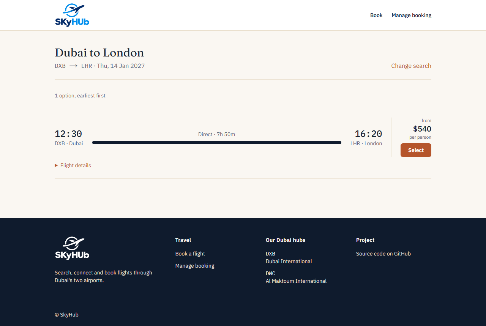
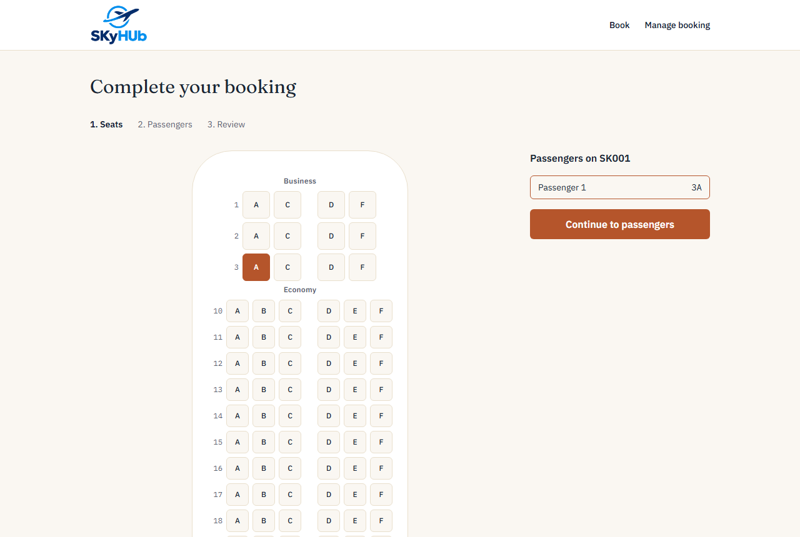
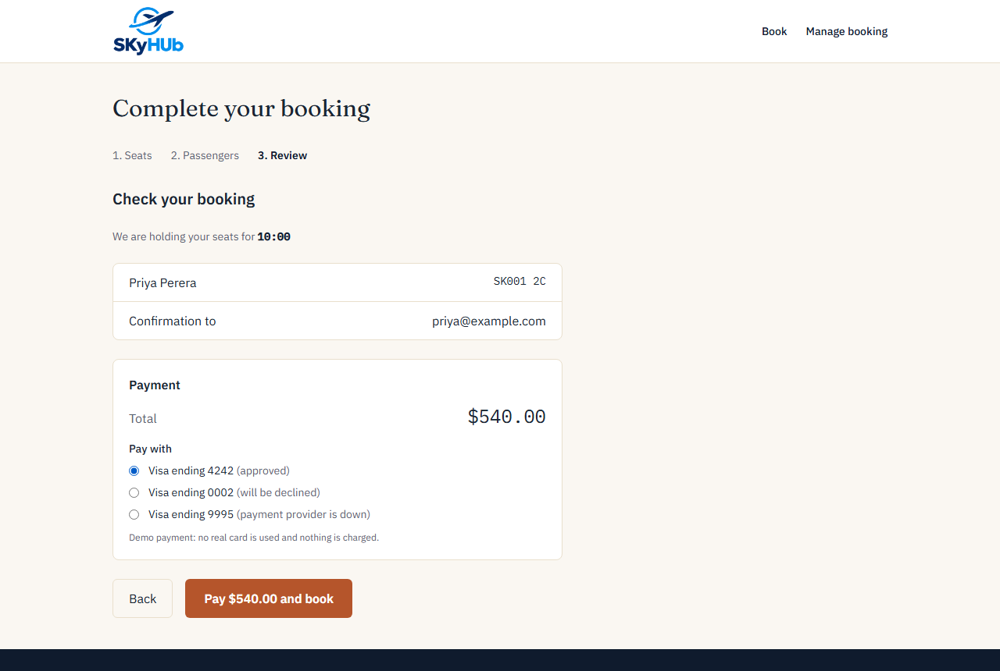
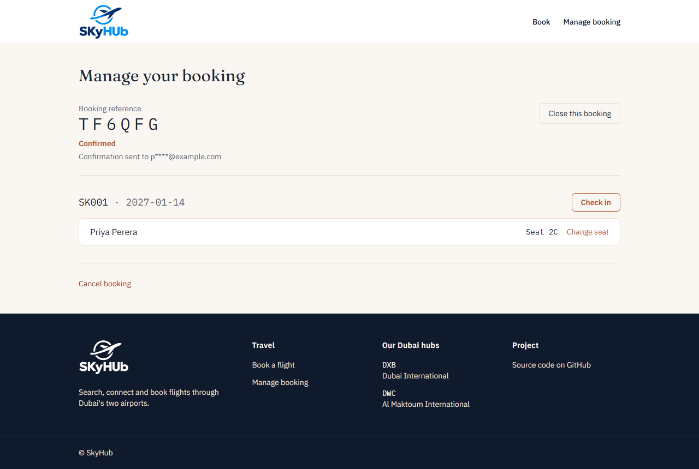
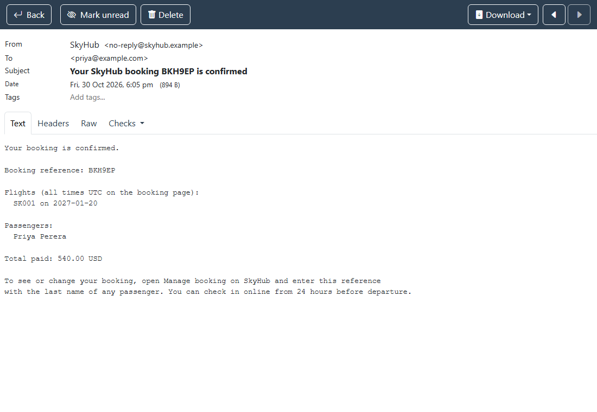
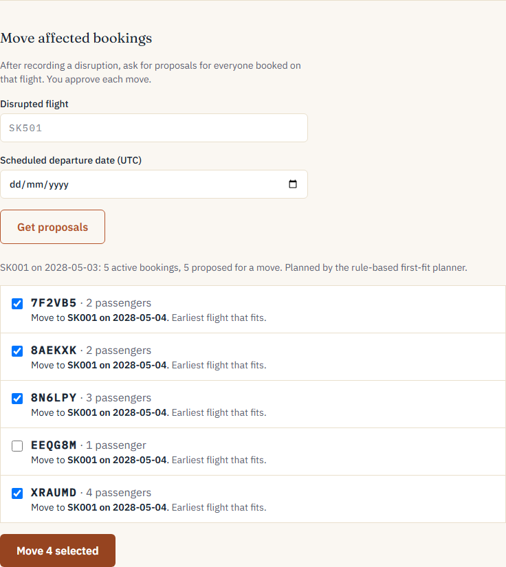
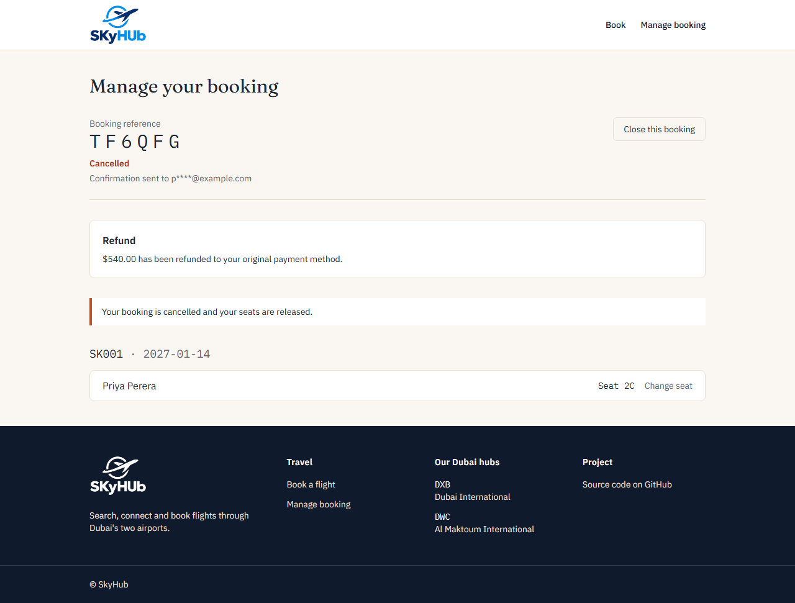
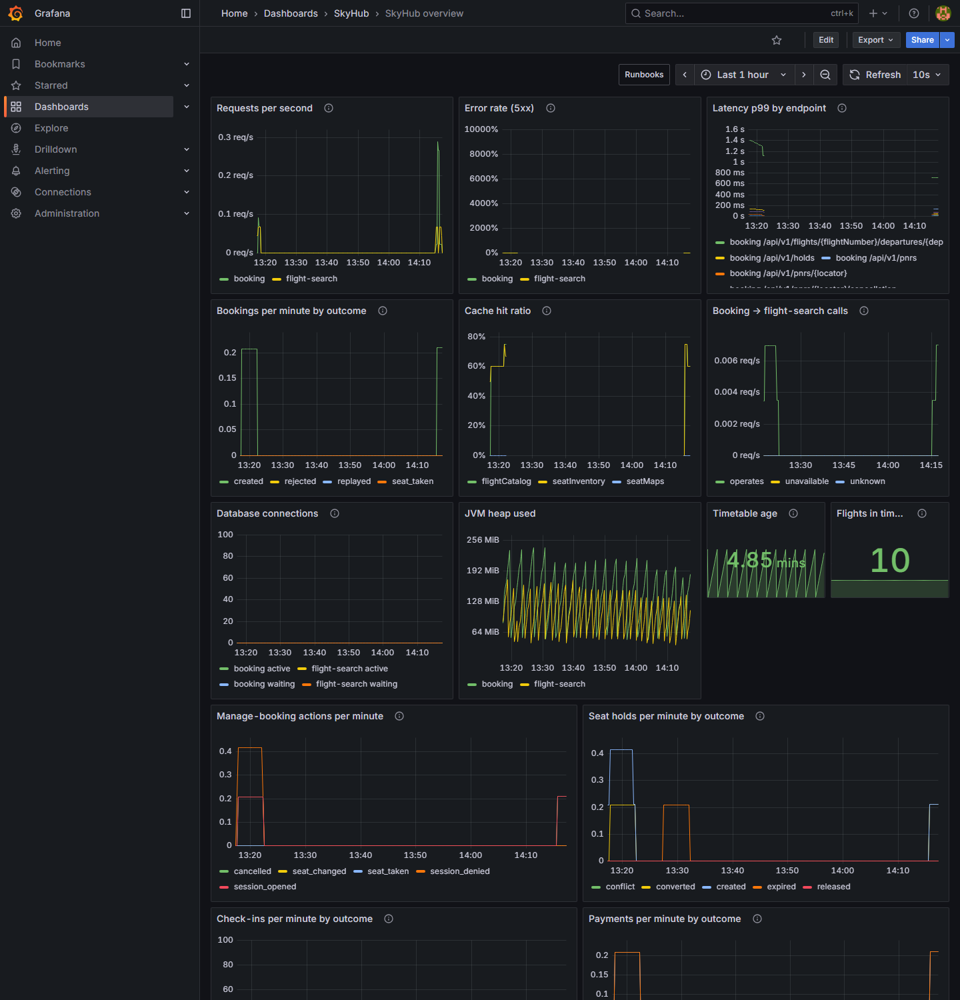
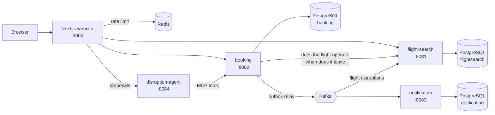

# SkyHub


A two-hub airline booking platform: search flights across **Dubai International (DXB)** and **Al Maktoum (DWC)**, pick seats, book, manage the booking and check in online.

SkyHub is a **portfolio project, not a real airline**. It is built the way a production system would be: API-first contracts, test-driven code, security and observability from the start, and a written reason for every significant decision.

## What you can do

| | |
|---|---|
| **Search** | Find flights between hubs and destinations, including connections that change airports between DXB and DWC. |
| **Choose seats** | A live seat map. Chosen seats are **held for 10 minutes** while you fill in passenger details, with a countdown. |
| **Book and pay** | One booking covers every flight of the trip. The server works out the price and charges it (demo payment methods, no real card); if booking then fails the charge is refunded. Repeating a request (double-click, retry) never books or charges twice. |
| **Manage** | Look up a booking with its reference and a passenger's last name, then change seats or cancel. |
| **Check in** | Opens 24 hours before departure. Gives each passenger a boarding pass with a signed barcode. |

## Screenshots

Taken from a local run (`docs/images/`).

| Search | Choose seats |
|---|---|
|  |  |

| Pay | Manage a booking |
|---|---|
|  |  |

| The confirmation email, caught by Mailpit | |
|---|---|
|  | |

| Operations: approving the agent's proposals | |
|---|---|
|  | |

| After cancelling: the refund | Grafana: *SkyHub overview* |
|---|---|
|  |  |

## Architecture



- **flight-search** keeps the timetable in memory (copy-on-write) and answers searches without touching the database.
- **booking** owns seats, holds, bookings and check-in. One database per service.
- **flight-search** also follows flight disruptions from a compacted Kafka topic, so a cancelled flight is never offered and a delay is shown; **booking** refuses to sell a cancelled flight at all, so nobody is charged for one.
- **notification** reads booking events from Kafka and sends the emails, once each. Booking never waits for it, so a mail or broker outage cannot fail a booking.
- **disruption-agent** (Python) reads a disruption and proposes where affected bookings could go; guardrails verify every proposal and a person decides. It reaches SkyHub through an MCP server and sees no personal data. With `--apply`, a person approves each proposed move (on the operations page, or `--apply` on the command line) and the booking service carries it out, audited under that person's name. See [`services/disruption-agent`](services/disruption-agent/README.md).
- **website** is the only thing the public reaches. It talks to the services from the server, so the browser never sees them or their tokens.

More in [`docs/design/01-hld.md`](docs/design/01-hld.md) (high-level) and [`docs/design/02-lld.md`](docs/design/02-lld.md) (classes and patterns).

## Engineering highlights

- **No double-selling.** Seats use optimistic locking (`@Version`). A test makes ten threads grab one seat at once; exactly one wins. → [ADR-0002](docs/adr/0002-optimistic-locking-for-seats.md)
- **Holds that cannot be abused or outlive their time.** All-or-nothing, 10 minutes, expiry checked when a hold becomes a booking *and* swept every 30 s by one idempotent SQL statement. → [ADR-0012](docs/adr/0012-seat-holds-that-expire.md)
- **Money that cannot be charged twice.** Charge first, book second, refund if booking fails; the charge key comes from the request's Idempotency-Key, so a retry after a crash finds the charge instead of making another. The price is the server's, never the browser's. → [ADR-0015](docs/adr/0015-payment-before-booking-with-compensation.md)
- **Events that cannot be lost or doubled.** A booking and its "confirmed" event are saved in one database transaction (outbox); a relay publishes to Kafka afterwards, and the consumer records each event id before sending, so a redelivery sends nothing twice. Stopping Kafka mid-booking delays the email; it does not fail the booking. → [ADR-0019](docs/adr/0019-transactional-outbox-and-kafka.md)
- **An AI agent that cannot do harm.** The model proposes re-accommodation; code checks every proposal against facts the tools returned (real flight, same route, fits the connection, enough seats across all proposals); a person approves. A fuzz test throws 200 hostile worlds at a deliberately bad model and an independent oracle finds zero unsafe answers. → [ADR-0022](docs/adr/0022-disruption-agent-proposes-code-verifies.md)
- **Search that follows reality, without slowing down.** Flight state travels on a *compacted* Kafka topic (the latest event per flight is kept forever); each search instance replays it into an in-memory map on start, so a lookup is O(1) and a restart loses nothing. Booking refuses to sell a cancelled flight, so search being a few seconds behind never costs a traveller money. → [ADR-0025](docs/adr/0025-cancelled-flights-are-not-sold-and-search-follows-disruptions.md)
- **Unique boarding numbers under concurrency** via a single atomic upsert; eight simultaneous check-ins get eight different numbers. Barcodes are HMAC-signed. → [ADR-0013](docs/adr/0013-online-check-in-and-boarding-passes.md)
- **Security.** Deny-by-default Spring Security; short-lived booking-scoped JWTs; personal data encrypted at rest (AES-256-GCM) and idempotency keys stored hashed; DTOs only at API boundaries; rate limiting at the edge. → [ADR-0009](docs/adr/0009-rate-limiting-at-the-edge.md), [0010](docs/adr/0010-encrypt-personal-data-at-rest.md), [0011](docs/adr/0011-manage-booking-with-a-short-lived-token.md)
- **Performance, measured on a laptop.** In-memory timetable: search went from 1,558 to 9,085 requests/s (median latency 92 ms to 2 ms). Cached seat maps: 1,762 to about 23,000 requests/s. → [ADR-0006](docs/adr/0006-in-memory-timetable-instead-of-result-cache.md)
- **Observability.** Prometheus metrics, JSON logs with trace ids, tracing, a Grafana dashboard, SLO alerts that each link to a [runbook](docs/runbooks/README.md). → [`docs/design/04-observability.md`](docs/design/04-observability.md)
- **Architecture rules are tests.** ArchUnit fails the build if the domain layer imports Spring or the web layer reaches into persistence.

All decisions are in [`docs/adr/`](docs/adr/README.md).

## Tech stack

Java 25, Spring Boot 4.1, Spring Security, Spring Data JPA (Hibernate), Flyway, PostgreSQL 18, Redis 8, Caffeine, OpenAPI Generator · Next.js 16, React 19, Tailwind 4 · JUnit, Mockito, Testcontainers, ArchUnit, Vitest · Micrometer, Prometheus, Grafana, Loki, Tempo. Why each was chosen: [`docs/design/00-tech-stack.md`](docs/design/00-tech-stack.md).

## Run it locally

You need **JDK 25**, **Node.js 24** (what CI uses), and **Docker**. The commands below are for a Unix-style shell (Git Bash on Windows works).

**1. Start PostgreSQL, Redis, Kafka and Mailpit**

```bash
docker compose up -d
```

If your PostgreSQL volume is from before the notification service existed, create its database once: `docker compose exec postgres psql -U skyhub -d postgres -c "CREATE DATABASE notification OWNER skyhub;"`.

**2. Create your keys.** The booking service refuses to start without them. Spring does not read `.env`, so export them in the shell that starts the service (see [`.env.example`](.env.example)). Use a different key for each.

```bash
export SKYHUB_PII_KEY=$(openssl rand -base64 32)
export SKYHUB_MANAGE_TOKEN_KEY=$(openssl rand -base64 32)
export SKYHUB_BOARDING_PASS_KEY=$(openssl rand -base64 32)
export SKYHUB_LINK_TOKEN_KEY=$(openssl rand -base64 32)   # also export the SAME value where the notification service starts (ADR-0046)
```

Keep `SKYHUB_PII_KEY` somewhere safe: bookings saved with one key cannot be read with another. `SKYHUB_LINK_TOKEN_KEY` is the one key that two services share: the booking service seals the one-time token in sign-up, reset and address-change events with it, and the notification service opens it to build the emailed link, so a reader of the Kafka topic cannot take it. Set the same value on both; without it on the notification service, booking emails still go out but those links are refused and parked (ADR-0046).

**3. Start the services** (each in its own terminal)

```bash
./mvnw -pl services/flight-search spring-boot:run     # http://localhost:8081
./mvnw -pl services/booking spring-boot:run           # http://localhost:8082  (needs the keys from step 2)
./mvnw -pl services/notification spring-boot:run      # no public API; reads Kafka, sends emails to Mailpit
```

Emailed links (a new account's "choose a password" link) point at the website. They use `http://localhost:3000` unless the notification service has `SKYHUB_SITE_URL` set, which any non-local setup must do (ADR-0033).

The notification service is optional for booking: bookings succeed without it, and the confirmation emails are sent when it starts (see ADR-0019). Open **http://localhost:8025** (Mailpit) to read the emails it sends: nothing is delivered outside your machine. To run with no mail server at all, set `SKYHUB_EMAIL_MODE=log` and the emails are written to the notification service's log instead (ADR-0021).

**4. Start the website**

```bash
cd frontend
npm ci
npm run dev                                           # http://localhost:3000
```

Search a route, pick seats, book, then use **Manage booking** with your reference and a passenger's last name. Check-in appears per flight and is only accepted inside its window (24 hours to 60 minutes before departure), so to try it you need a flight leaving within the next day.

**Optional: metrics, logs and traces**

```bash
docker compose --profile observability up -d          # Grafana at http://localhost:3001
```

Set `GRAFANA_ADMIN_PASSWORD` first (see `.env.example`). Open the *SkyHub overview* dashboard.

## Tests

```bash
./mvnw verify                  # both services; integration tests start PostgreSQL in Docker
cd frontend && npm test        # unit and component tests
cd frontend && npm run typecheck && npx eslint src
```

**End-to-end (a real browser):** with both services, PostgreSQL and the website running as in *Run it locally*, run `cd frontend && npx playwright install chromium` once, then `npm run e2e`. It books a flight, pays with the test card, looks the booking up, cancels it and checks the refund. A second test signs in to the operations screen (`/ops`) and records a cancellation; it needs a staff account, so start the booking service with `SKYHUB_BOOTSTRAP_ADMIN_USERNAME` / `SKYHUB_BOOTSTRAP_ADMIN_PASSWORD` and pass the same pair as `SKYHUB_E2E_STAFF_USER` / `SKYHUB_E2E_STAFF_PASSWORD` (without them that test is skipped). With the notification service and Mailpit running, set `SKYHUB_MAILPIT_URL=http://localhost:8025` and the journey also checks that the confirmation email arrives after booking and the cancellation email after cancelling. It is not part of CI because it needs the whole stack.

CI runs the same on every pull request.

## Repository layout

```
api-specs/      OpenAPI contracts, written before the code (the services generate their interfaces from them)
services/       flight-search, booking and notification (Spring Boot), and disruption-agent (Python)
frontend/       the website (Next.js)
observability/  Prometheus rules, Grafana dashboard, Loki / Tempo / Alloy config
docs/           design documents, decision records (ADRs), runbooks, and the [roadmap](docs/ROADMAP.md) of what is done and pending
```

## Status and honest limits

Built so far: search, seat selection, booking with payment (mock provider), refunds on cancellation, manage booking, seat holds, online check-in, delays and cancellations (cancelled flights are neither offered nor sold), staff login with roles and an operations screen, a disruption agent that proposes re-accommodation and, with a person's approval, moves bookings (audited, seats kept together), emails for a confirmed booking, a cancellation (with its refund) and a delayed or cancelled flight, through an outbox and Kafka, observability.

Not built, on purpose or not yet: a real payment provider, grouping and filtering of rebooking proposals on big flights (approving 500 bookings is 10 bulk calls, ADR-0035) and a live test of the agent's Groq model, a real mail provider (emails go to Mailpit locally; the SMTP adapter works with any relay) and check-in reminders, automatic re-accommodation, a real boarding-pass image (QR/PDF417), and per-passenger check-in. The airline and its flights are fictional.
