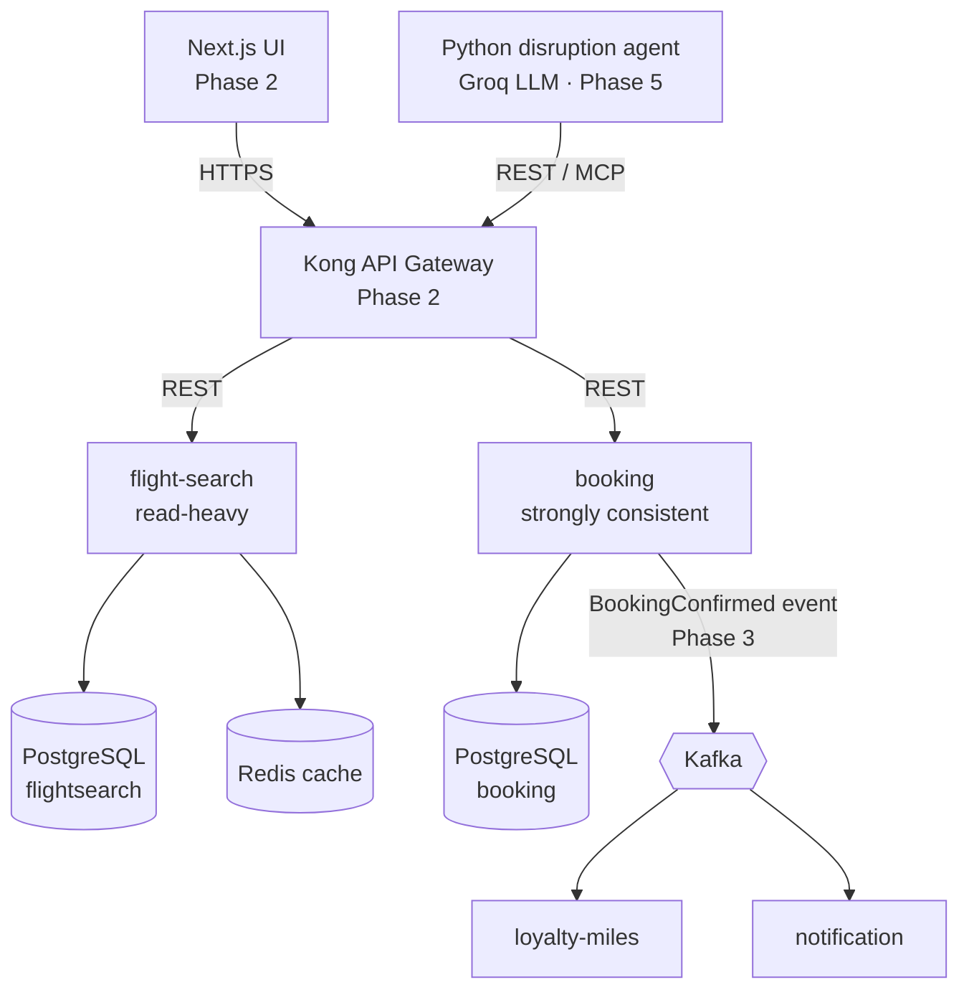

# SkyHub — High-Level Design

**Status:** Draft · **Scope:** Phase 1 (flight-search, booking) with the target architecture for later phases

## 1. Context

SkyHub is a booking platform for a fictional airline that runs **two hubs in one city**: Dubai International (DXB) and Al Maktoum International (DWC). Traffic is moving from DXB to DWC over several years, so the system must:

- treat hubs as **configuration**, not hard-coded values;
- support connections **between the two airports** (land at DXB, depart from DWC);
- let routes move between hubs without code changes.

## 2. Requirements

### 2.1 Functional (Phase 1)

| # | Requirement |
|---|---|
| F1 | Search itineraries by origin, destination and date. Return direct and one-stop options. |
| F2 | Connections can go through DXB or DWC, including transfers between them. |
| F3 | A hub can be activated or deactivated through configuration. |
| F4 | Show the seat map of a flight on a date. |
| F5 | Create a booking (PNR) for 1–9 passengers with seat selection. |
| F6 | Retrieve a booking by its 6-character locator. |

### 2.2 Non-functional

| Quality | Target |
|---|---|
| Consistency | **A seat is never sold twice.** No exceptions. |
| Latency | Search p95 < 300 ms when cached; < 1 s uncached |
| Availability | Search keeps working when booking is down (independent services) |
| Idempotency | Repeating the same booking request never creates a second PNR |
| Observability | Health checks and structured logs from day one |
| Testability | Domain logic is pure Java and testable without Spring |
| Security | No secrets in the repository; input validated at the API boundary |

## 3. Capacity estimate

Airlines see roughly **100 searches per booking** (the look-to-book ratio).

| Metric | Estimate |
|---|---|
| Searches | 1M/day ≈ 12/s average, ≈ 120/s at 10× peak |
| Bookings | 10k/day ≈ 0.1/s average; bursts on sale days |
| Schedule data | a few thousand rows — fits in memory and cache easily |
| Seat inventory | ~200 seats × flights × 365 days ≈ millions of rows per year |

**Conclusions**
- Search is **read-heavy**, so caching gives the biggest win.
- Booking volume is low, but many requests compete for the same popular seats. The hard part is **correctness under concurrency**, not throughput.

## 4. Architecture

### 4.1 Services

| Service | Responsibility | Data it owns | Phase |
|---|---|---|---|
| flight-search | Schedules, hub network, itinerary search | `flight_schedule` | 1 |
| booking | Seat inventory, PNRs | `seat_inventory`, `pnr`, `pnr_passenger` | 1 |
| api-gateway (Kong) | Routing, auth, rate limiting | — | 2 |
| notification | Email/SMS on booking events | sent messages | 3 |
| loyalty-miles | Accrue miles on booking events | member accounts | 3 |
| disruption-agent | Rebook passengers after cancellations | agent sessions | 5 |

### 4.2 Communication

- **Synchronous REST** for queries and commands the user waits for (search, book).
- **Asynchronous events** (Kafka) for side effects the user does not wait for (email, miles). A failing email service must never fail a booking.
- Events will be published using the **transactional outbox** pattern (Phase 3), so a booking and its event are committed together.

## 5. Key decisions

Each decision has (or will have) an ADR in [`docs/adr`](../adr/README.md).

| ADR | Decision | Trade-off accepted |
|---|---|---|
| 0001 | Hubs and inter-airport transfers are configuration | Configuration must be validated at startup |
| 0002 | Optimistic locking (`@Version`) for seats | Conflicting users get a 409 and must pick again |
| 0003 | Database per service | No cross-service joins; eventual consistency between services |
| 0004 | Store schedules, derive dated flights | Each search computes legs from the schedule |
| 0005 | All times stored and computed in UTC | Conversion to local time happens in the UI |
| 0006 | Cache-aside search results in Redis, 5-minute TTL | Results may be up to 5 minutes stale (search is not seat stock) |
| 0007 | REST for queries, events for side effects | Needs an outbox and idempotent consumers |
| 0008 | `Idempotency-Key` header on `POST /pnrs` | Keys must be stored and checked |

## 6. Consistency model

| Data | Model | How |
|---|---|---|
| Seat inventory | **Strong** | Single PostgreSQL transaction + optimistic locking + unique constraint |
| Search results | **Eventual** (≤ 5 min) | Cache TTL |
| Booking → miles / notifications | **Eventual** | Kafka events (Phase 3) |

## 7. Failure handling

| Scenario | Behaviour |
|---|---|
| Redis down | Search falls back to the database: slower but working |
| Two users select the same seat | One gets `201 Created`, the other `409 Conflict` |
| Client retries `POST /pnrs` after a timeout | Same `Idempotency-Key` → original PNR returned, nothing booked twice |
| booking database down | Booking returns `503`; search unaffected |
| Invalid hub configuration (e.g. `DXBB`) | Service **fails to start** with a clear message (fail fast) |
| ✍️ *Your scenario* | |
| ✍️ *Your scenario* | |

## 8. Security (baseline)

- All input validated against the OpenAPI contract (patterns, sizes, formats).
- Errors return ProblemDetail without stack traces or SQL.
- Secrets (database passwords, Groq API key) come from environment variables; `.env` is git-ignored.
- Phase 2: JWT authentication at the gateway; rate limiting on search.

## 9. Observability

- Spring Boot Actuator: `/actuator/health` (liveness/readiness) and `/actuator/info`.
- Structured logs with a correlation ID per request (Phase 2).
- Metrics → Prometheus → Grafana; traces via OpenTelemetry (Phase 4).

## 10. Roadmap

| Phase | Scope |
|---|---|
| 1 | flight-search + booking, Docker Compose, CI |
| 2 | Next.js UI, Kong gateway, JWT auth, correlation IDs, seat holds |
| 3 | Kafka, outbox, notification and loyalty-miles services |
| 4 | Kubernetes + Helm, SonarQube gate, OpenTelemetry, Grafana, load tests |
| 5 | Python disruption agent on Groq, MCP server, eval suite |
