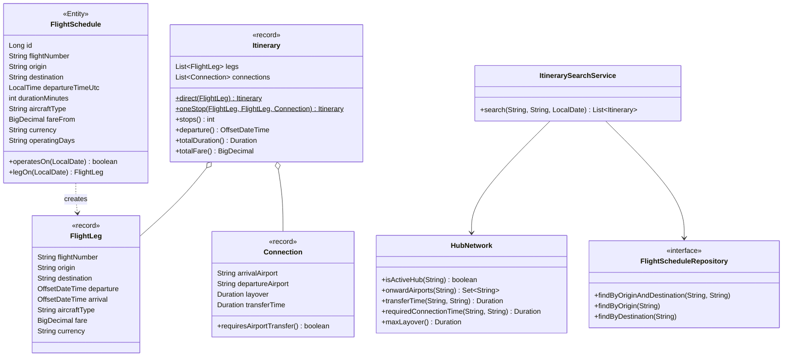
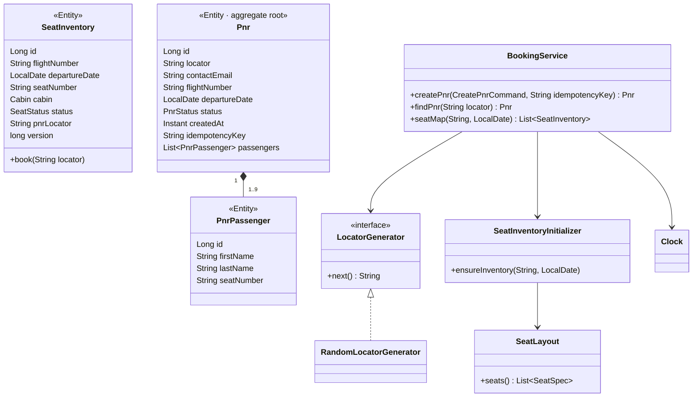
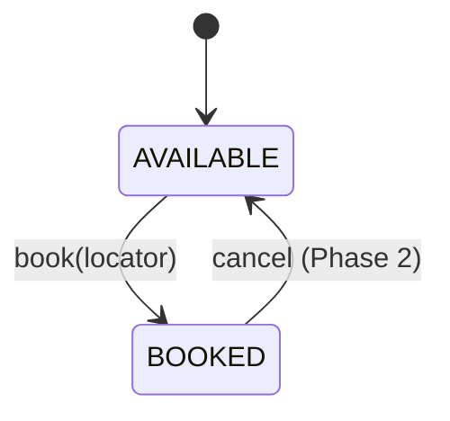
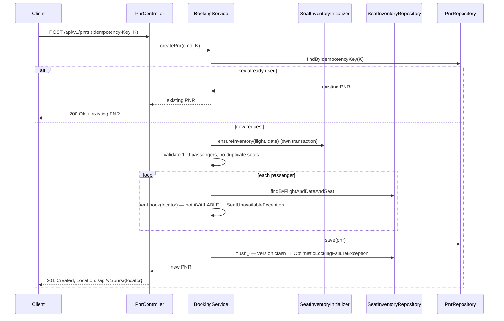

# SkyHub — Low-Level Design (Phase 1)

## 1. Repository layout

```
skyhub/
├── pom.xml                      # parent: modules, plugin + dependency management
├── api-specs/
│   ├── flight-search-api.yaml   # OpenAPI 3 — written BEFORE code
│   └── booking-api.yaml
├── services/
│   ├── flight-search/
│   └── booking/
├── docs/
│   ├── design/                  # these documents
│   └── adr/
├── docker-compose.yml
└── .github/workflows/ci.yml
```

## 2. Package structure (same in both services)

```
com.skyhub.<service>
├── api/            generated from OpenAPI — never edited by hand
├── web/            controllers (implement generated interfaces), DTO mappers, exception handler
├── application/    use-case services; @Transactional and @Cacheable live here
├── domain/         pure Java: entities, records, rules — NO Spring imports
├── persistence/    Spring Data repositories
└── config/         @ConfigurationProperties, cache and bean configuration
```

**Dependency rule:** `web → application → domain ← persistence`. The domain depends on nothing. An ArchUnit test enforces this.

> JPA annotations on domain entities are a pragmatic exception (`jakarta.persistence` only, never `org.springframework`).

## 3. flight-search

### 3.1 Configuration

```yaml
skyhub:
  hubs:
    - code: DXB
      name: Dubai International
      active: true
      minimum-connection-time: 75m
    - code: DWC
      name: Al Maktoum International
      active: true
      minimum-connection-time: 60m
  airport-transfers:
    - from: DXB
      to: DWC
      duration: 120m
  max-layover: 12h
```

Validation at startup (fail fast): hub codes match `^[A-Z]{3}$`, no duplicate codes, both ends of a transfer are configured hubs, durations are positive.

### 3.2 Classes



`HubNetwork` is a plain domain class built from `HubProperties` by a `@Bean` method in `config/`. That keeps it testable with `new HubNetwork(...)`.

### 3.3 Connection rules

| Case | Required connection time |
|---|---|
| Arrive and depart at the same hub | that hub's minimum connection time (MCT) |
| Arrive at one hub, depart from the other | transfer time + **departure** hub's MCT |
| Any case | layover must also be ≤ `max-layover` |

Example: arrive DXB, depart DWC → 120m transfer + 60m DWC MCT = **180m** minimum.

### 3.4 Search algorithm

```
search(origin, destination, date):
    require origin != destination
    results = []

    # direct
    for s in repo.findByOriginAndDestination(origin, destination):
        if s.operatesOn(date): results += Itinerary.direct(s.legOn(date))

    # one stop
    onward = repo.findByDestination(destination)
    for first in repo.findByOrigin(origin):
        if not first.operatesOn(date) or not hubs.isActiveHub(first.destination): continue
        inbound = first.legOn(date)
        for airport in hubs.onwardAirports(inbound.destination):
            required = hubs.requiredConnectionTime(inbound.destination, airport)
            for second in onward where second.origin == airport:
                for day in [inbound.arrival.date, inbound.arrival.date + 1]:
                    if not second.operatesOn(day): continue
                    outbound = second.legOn(day)
                    layover = outbound.departure - inbound.arrival
                    if required <= layover <= hubs.maxLayover:
                        results += Itinerary.oneStop(inbound, outbound,
                                     Connection(inbound.destination, airport, layover,
                                                hubs.transferTime(inbound.destination, airport)))

    sort results by departure, then totalDuration
    return results
```

✍️ **Exercise:** state the time complexity in terms of the number of schedules from the origin (O) and into the destination (D). Which indexes does `flight_schedule` need?

### 3.5 Caching

- `@Cacheable(cacheNames = "itineraries", key = "#origin + ':' + #destination + ':' + #date")`
- Redis, TTL 5 minutes. Cached types implement `Serializable` (or configure a JSON serializer).
- Tests run with `spring.cache.type=simple`.

## 4. booking

### 4.1 Classes



Design-for-testability choices:
- `LocatorGenerator` is an interface → tests use a fixed locator.
- `java.time.Clock` is injected → tests use `Clock.fixed(...)`.
- `SeatInventoryInitializer` is a separate bean so `@Transactional(REQUIRES_NEW)` actually applies (Spring proxies ignore self-invocation).

### 4.2 Seat layout (Phase 1: one aircraft type)

| Cabin | Rows | Seats per row |
|---|---|---|
| BUSINESS | 1–3 | A, C, D, F |
| ECONOMY | 10–35 | A, B, C, D, E, F |

Inventory for a flight/date is created lazily on first access. A unique constraint on `(flight_number, departure_date, seat_number)` makes concurrent initialisation safe: the loser's insert fails and is ignored.

### 4.3 Seat state machine



✍️ **Exercise (Phase 2):** add `HELD` with a 15-minute expiry and automatic release. Redraw this diagram.

### 4.4 Locator

6 characters from `ABCDEFGHJKLMNPQRSTUVWXYZ23456789` (no 0/O, 1/I), generated with `SecureRandom`. 32⁶ ≈ 1.07 billion combinations; a unique constraint catches the rare collision.

### 4.5 Create-PNR flow



### 4.6 Concurrency

Two users read seat 12A at version 0. Both mark it BOOKED. The first commit runs `UPDATE ... SET version = 1 WHERE id = ? AND version = 0` and succeeds. The second runs the same statement, matches **0 rows**, and Hibernate throws an optimistic-lock exception, which the API returns as **409**.

If the second user reads 12A *after* the first commit, `book()` sees `BOOKED` and throws `SeatUnavailableException` — also **409**.

## 5. Database schema

### flight-search

```sql
CREATE TABLE flight_schedule (
    id                 BIGINT GENERATED BY DEFAULT AS IDENTITY PRIMARY KEY,
    flight_number      VARCHAR(8)    NOT NULL,
    origin             CHAR(3)       NOT NULL,
    destination        CHAR(3)       NOT NULL,
    departure_time_utc TIME          NOT NULL,
    duration_minutes   INT           NOT NULL CHECK (duration_minutes > 0),
    aircraft_type      VARCHAR(10)   NOT NULL,
    fare_from          NUMERIC(10,2) NOT NULL,
    currency           CHAR(3)       NOT NULL,
    operating_days     VARCHAR(7)    NOT NULL
);
CREATE INDEX ix_schedule_origin      ON flight_schedule (origin);
CREATE INDEX ix_schedule_destination ON flight_schedule (destination);
```

### booking

```sql
CREATE TABLE seat_inventory (
    id             BIGINT GENERATED BY DEFAULT AS IDENTITY PRIMARY KEY,
    flight_number  VARCHAR(8)  NOT NULL,
    departure_date DATE        NOT NULL,
    seat_number    VARCHAR(4)  NOT NULL,
    cabin          VARCHAR(10) NOT NULL,
    status         VARCHAR(10) NOT NULL,
    pnr_locator    CHAR(6),
    version        BIGINT      NOT NULL DEFAULT 0,
    CONSTRAINT uq_seat UNIQUE (flight_number, departure_date, seat_number)
);

CREATE TABLE pnr (
    id              BIGINT GENERATED BY DEFAULT AS IDENTITY PRIMARY KEY,
    locator         CHAR(6)      NOT NULL UNIQUE,
    contact_email   VARCHAR(254) NOT NULL,
    flight_number   VARCHAR(8)   NOT NULL,
    departure_date  DATE         NOT NULL,
    status          VARCHAR(10)  NOT NULL,
    created_at      TIMESTAMP WITH TIME ZONE NOT NULL,
    idempotency_key VARCHAR(64)  UNIQUE
);

CREATE TABLE pnr_passenger (
    id          BIGINT GENERATED BY DEFAULT AS IDENTITY PRIMARY KEY,
    pnr_id      BIGINT       NOT NULL REFERENCES pnr (id),
    first_name  VARCHAR(50)  NOT NULL,
    last_name   VARCHAR(50)  NOT NULL,
    seat_number VARCHAR(4)   NOT NULL
);
CREATE INDEX ix_passenger_pnr ON pnr_passenger (pnr_id);
```

## 6. API contract

| Method + path | Success | Errors |
|---|---|---|
| `GET /api/v1/hubs` | 200 | — |
| `GET /api/v1/itineraries?origin&destination&date` | 200 | 400: bad code, missing date, origin = destination |
| `GET /api/v1/flights/{flightNumber}/departures/{date}/seats` | 200 | 400 |
| `POST /api/v1/pnrs` (header `Idempotency-Key`) | 201 + `Location`; 200 on replay | 400 validation, 409 seat unavailable |
| `GET /api/v1/pnrs/{locator}` | 200 | 404 |

All errors are `application/problem+json` (RFC 9457).

### Exception → HTTP mapping

| Exception | Status |
|---|---|
| Bean validation / `ConstraintViolationException` / `IllegalArgumentException` from domain checks | 400 |
| `InvalidBookingException` (duplicate seats, unknown seat, passenger count) | 400 |
| `PnrNotFoundException` | 404 |
| `SeatUnavailableException`, `OptimisticLockingFailureException` | 409 |
| Anything else | 500 (logged, generic message to client) |

## 7. Seed data (flight-search, `V2__seed.sql`)

Designed so every connection rule has a test case.

| Flight | Route | Days | Departs (UTC) | Duration | Arrives (UTC) |
|---|---|---|---|---|---|
| SK501 | CMB → DXB | daily | 02:00 | 290 | 06:50 |
| SK001 | DXB → LHR | daily | 08:30 | 470 | 16:20 |
| SK201 | BOM → DXB | daily | 03:00 | 190 | 06:10 |
| SK203 | BOM → DWC | daily | 04:30 | 190 | 07:40 |
| SK901 | DWC → JFK | daily | 10:30 | 840 | 00:30 +1 |
| SK411 | DWC → SYD | 1,3,5 | 11:00 | 840 | 01:00 +1 |

| Search | Expected |
|---|---|
| CMB → LHR | SK501 + SK001, 100m at DXB, no transfer |
| CMB → JFK | SK501 + SK901, 220m, **DXB → DWC transfer** |
| BOM → JFK | SK203 + SK901 (170m at DWC) and SK201 + SK901 (260m, transfer) |
| CMB → JFK with DWC inactive | no results |
