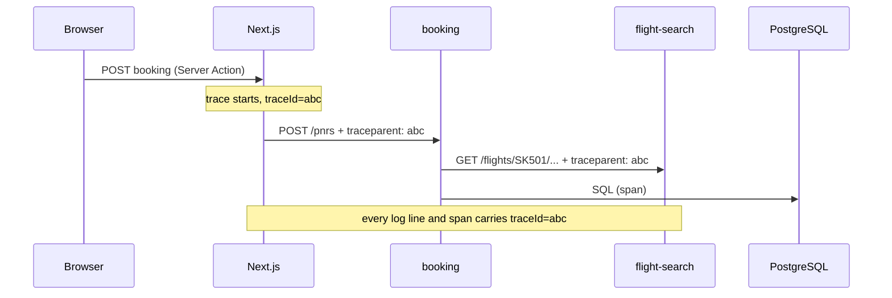

# SkyHub — Observability Design

**Goal:** for any problem in production, answer three questions in under five minutes: *is it broken* (metrics and alerts), *where* (traces), and *why* (logs) — and jump between them using one trace ID.

## 1. Stack

| Signal | Produced by | Collected by | Stored in | Viewed in |
|---|---|---|---|---|
| Metrics | Micrometer (Java), `prom-client` (Next.js) | Prometheus scrapes `/actuator/prometheus` every 15 s | Prometheus | Grafana dashboards |
| Logs | Spring Boot structured JSON (ECS format), `pino` JSON (Next.js) | Grafana Alloy reads container stdout | Loki | Grafana Explore |
| Traces | Micrometer Tracing → OpenTelemetry (Java), `@opentelemetry` SDK (Next.js) | OTLP to Grafana Alloy | Tempo | Grafana, linked from logs and metrics |
| Alerts | Prometheus alerting rules | — | — | Grafana / Alertmanager |

Everything runs locally from `docker compose --profile observability up`. Dashboards, data sources and alert rules are **provisioned as code** in `observability/`, versioned with the services.

## 2. Correlation: one ID across every hop

- W3C `traceparent` propagates automatically through instrumented HTTP clients. The booking → flight-search `RestClient` must be built from Spring's auto-configured, observation-aware builder.
- Every JSON log line includes `traceId` and `spanId`, so Grafana jumps from a log line to its trace and back.
- Responses carry an `X-Trace-Id` header; error pages show it so a user can quote it to support.

## 3. Metrics

### 3.1 Golden signals (automatic, per service and endpoint)

| Signal | Metric | Notes |
|---|---|---|
| Rate | `http_server_requests_seconds_count` | by `uri` template, `method`, `status` |
| Errors | same, `status=~"5.."` | 4xx tracked separately: validation errors are not outages |
| Duration | `http_server_requests_seconds_bucket` | histograms enabled → p50/p95/p99 in PromQL |
| Saturation | `hikaricp_connections_active / max`, `hikaricp_connections_pending`, `jvm_memory_used_bytes`, `jvm_gc_pause_seconds` | pending connections > 0 is the earliest overload signal |

### 3.2 Business and design metrics (custom)

| Metric | Type | Why it matters |
|---|---|---|
| `skyhub_bookings_total{outcome=created\|replayed\|seat_taken\|rejected}` | counter | Booking success rate; conflicts show contention on popular flights |
| `skyhub_flight_catalog_calls_total{result=operates\|unknown\|unavailable}` | counter | Health of the booking → flight-search dependency |
| `cache_gets_total{cache=seatMaps\|flightCatalog\|seatInventory, result=hit\|miss}` | counter (Caffeine stats) | Proves the caches earn their place (ADR-0006) |
| `skyhub_timetable_flights` | gauge | Sanity: an empty timetable means a broken load |
| `skyhub_timetable_last_refresh_seconds` | gauge (Unix time) | Stale timetable alert |
| `skyhub_rate_limit_rejections_total{policy}` | counter (Next.js) | Abuse or limits set too tight |

**Cardinality rule:** labels only take small, fixed sets of values. Never use locators, flight numbers, user IDs or emails as labels — they go in logs and traces instead.

## 4. Logs

| Rule | Detail |
|---|---|
| Format | JSON, one object per line (Spring Boot `logging.structured.format.console=ecs`) |
| Always present | `@timestamp`, `log.level`, `service.name`, `traceId`, `spanId`, `message` |
| Business events at INFO | `booking.created locator=… segments=2 passengers=2`, `booking.seat_taken flight=… seat=…`, `timetable.loaded flights=…` |
| Never logged | Email addresses, names, idempotency keys, request bodies, encryption keys. `ContactEmail.toString()` is already masked |
| Levels | ERROR = needs a human; WARN = degraded but serving (timetable refresh failed, catalog unavailable); INFO = business events and lifecycle; DEBUG off in production |
| Errors | One stack trace, logged once, at the boundary (`ApiExceptionHandler`) — not at every layer |

## 5. Dashboards (provisioned)

| Dashboard | Panels |
|---|---|
| **SkyHub overview** | Requests/s, error %, p95 and p99 per service; bookings per minute by outcome; seat conflicts; dependency health (catalog calls by result) |
| **Search** | Search p50/p95/p99, timetable size and age, top routes by request rate (from logs) |
| **Booking** | Bookings by outcome, idempotent replays, seat-map cache hit ratio, inventory creations, 404s for unknown flights |
| **JVM and database** | Heap, GC pauses, virtual threads, Hikari active/pending connections, query time |
| **Edge (Next.js)** | Page and action latency, rate-limit rejections by policy, Redis latency |

## 6. SLOs and alerts

| SLO | Target | Alert (fires when) |
|---|---|---|
| Search availability | 99.9% non-5xx over 30 days | Error ratio > 1% for 5 min |
| Search latency | p99 < 200 ms | p99 > 200 ms for 10 min |
| Booking availability | 99.5% of booking attempts end in a decision (created, replayed, seat taken, rejected) | 5xx ratio on `POST /pnrs` > 2% for 5 min |
| Timetable freshness | Reloaded within 15 min | `time() - skyhub_timetable_last_refresh_seconds > 900` |
| Database headroom | No waiting for connections | `hikaricp_connections_pending > 0` for 2 min |
| Dependency | Catalog reachable | `unavailable` results > 5% for 5 min |

Alerts link to a short runbook in `docs/runbooks/` (what it means, how to confirm, how to mitigate).

## 7. Security of the telemetry

- Actuator runs on a **separate management port** (9081 / 9082) that is not exposed outside the cluster; the public port still serves only the API contract (deny-by-default).
- Grafana requires login; anonymous access is off.
- Logs and traces are checked for PII by a test that books a PNR and asserts the email and names never appear in captured log output.

## 8. Build plan (next slice, test-first)

| Step | Deliverable | Verified by |
|---|---|---|
| 1 | Prometheus endpoint on a management port in both services; histograms on | Test: `/actuator/prometheus` on the management port, 403 on the public port |
| 2 | Structured JSON logs with trace IDs; business events; PII test | Test captures logs during a booking: JSON, has `traceId`, no email or names |
| 3 | Custom metrics (bookings, catalog, caches, timetable) | Tests assert counters change after actions |
| 4 | Tracing across Next.js → booking → flight-search | One trace in Tempo shows all three services for a booking |
| 5 | Docker Compose profile: Prometheus, Grafana, Loki, Tempo, Alloy | `docker compose --profile observability up` then all targets UP |
| 6 | Provisioned dashboards and alert rules + runbooks | Load test makes panels move; a stopped flight-search fires the dependency alert |
| 7 | Screenshots and an "Observability" section in the README | Portfolio |
